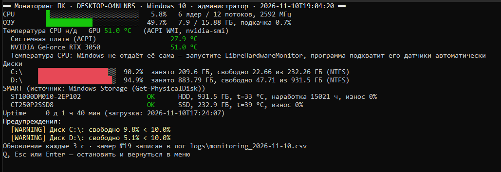

# PC Monitor

Консольная программа на Python для слежения за состоянием компьютера. Это практическое задание №2: нужно было собрать данные о загрузке процессора, памяти, температуре, дисках и SMART, писать всё это в лог и предупреждать, если что-то выходит за допустимые пределы.

Что программа умеет:

- показывает загрузку CPU и RAM, температуру процессора и видеокарты, место на дисках, состояние SSD/HDD по SMART и uptime, обновляет экран каждые 2–5 секунд;
- каждый замер пишет в лог (CSV, открывается в Excel) и в историю;
- по истории считает статистику за последний час, сутки или неделю;
- после каждого сеанса мониторинга сама сохраняет отчёт;
- ругается, если диск почти заполнен, процессор перегрелся или SMART показывает проблемы.

Скриншоты с моего компьютера лежат в [docs/screenshots](docs/screenshots), а настоящие лог и отчёты, которые программа на нём создала, — в [docs/demo](docs/demo).



## Как запустить

### Готовый exe (Python не нужен)

Берём `dist/PCMonitor.zip`, распаковываем куда угодно, запускаем `PCMonitor.exe`. Если zip нет, его собирает `build_exe.bat` (нужен Python и PyInstaller, батник ставит его сам).

Рядом с exe появятся папки `data`, `logs` и `reports`. Если писать рядом с exe нельзя (например, он лежит в Program Files), данные уйдут в `%LOCALAPPDATA%\PCMonitor`. Под конкретный компьютер ничего не настроено: диски, датчики и видеокарта определяются при каждом запуске, так что exe можно просто скопировать на другую машину.

Windows может показать окно SmartScreen, потому что exe не подписан. Жмём «Подробнее» → «Выполнить в любом случае».

### Из исходников

Нужен Python 3.9 или новее (проверено на 3.12).

```bash
python -m pip install -r requirements.txt
python monitor.py
```

Или двойной щелчок по `start.bat`.

## Меню

```
========================================
   МОНИТОРИНГ СОСТОЯНИЯ ПК
========================================
1. Текущий мониторинг
2. Мониторинг за период
3. Создать отчёт
4. Отчёт мониторинга
5. Логи мониторинга

0. Выход
```

**1. Текущий мониторинг.** Спрашивает интервал (2–5 с) и рисует экран как на картинке выше. Каждый замер сразу дописывается в `logs/monitoring_ГГГГ-ММ-ДД.csv` (на каждый день свой файл) и в `data/history.jsonl`, внизу экрана видно, какой по счёту замер записан. Остановить можно клавишей Q, Esc или Enter. После остановки программа считает статистику по сеансу, показывает её и сохраняет в `reports/monitoring/`.

**2. Мониторинг за период.** Статистика из истории за последний час, 24 часа или 7 дней: средняя и максимальная загрузка CPU и RAM, минимальная и максимальная температура, как изменилось свободное место на каждом диске, сколько было предупреждений и сколько всего замеров.

**3. Создать отчёт.** Та же статистика, но в файл: TXT, JSON или CSV. Файл ложится в `reports/`, его можно сразу открыть.

**4. Отчёт мониторинга.** Список отчётов, которые сохранились после сеансов из пункта 1. Новые сверху.

**5. Логи мониторинга.** Список логов из `logs/` с датой последнего замера. После выбора лога программа показывает последние 30 замеров таблицей и итог по файлу. Лог можно открыть в Excel.

Про CSV: дробные числа пишутся через запятую (`21,6`), а столбцы разделяются точкой с запятой. Сначала было через точку, и русский Excel превращал `21.6` в дату «21.июн». Теперь открывается нормально.

## Про температуру процессора

Это самый частый вопрос, поэтому отдельно. Windows не умеет отдавать температуру ядер процессора стандартными средствами, даже если запустить программу от администратора. Поэтому:

- температура видеокарты NVIDIA берётся из `nvidia-smi` (ставится вместе с драйвером) и работает всегда;
- температуру процессора, а также видеокарт AMD/Intel можно получить через бесплатную [LibreHardwareMonitor](https://github.com/LibreHardwareMonitor/LibreHardwareMonitor). Её надо запустить от администратора, и PC Monitor сам подхватит её датчики;
- без неё в строке «Температура CPU» будет «н/д» с подсказкой, всё остальное работает.

Датчик «Системная плата (ACPI)» показывает температуру с материнской платы. Это не температура процессора.

## Другие режимы (командная строка)

Меню нужно человеку, а для скриптов есть команды:

```bash
python monitor.py snapshot              # один замер и выход
python monitor.py snapshot --json       # то же в JSON
python monitor.py monitor -i 10         # мониторинг каждые 10 с до Ctrl+C
python monitor.py monitor -i 5 -d 600 -o logs/day.jsonl --report reports/day.txt
python monitor.py monitor -i 30 --quiet # фоном, печатает только предупреждения
python monitor.py report logs/demo.csv  # отчёт по готовому логу
```

У `monitor` есть ключи `-i` (интервал, по умолчанию 10 с), `-d` (длительность, 0 = пока не нажмут Ctrl+C), `-o` (файл лога, формат по расширению .csv или .jsonl), `--smart-every` (как часто опрашивать SMART, по умолчанию раз в 300 с, потому что это медленно), `--quiet` и `--report`. Общие ключи: `--thresholds файл.json`, `--no-color`, `-v`.

`snapshot` возвращает код 2, если нашёл что-то критичное. Это удобно, чтобы проверять компьютер из планировщика.

## Пороги

Настраиваются в `thresholds.json`, по умолчанию такие:

| Что | Порог | Уровень |
|---|---|---|
| Загрузка CPU | больше 90 % | WARNING |
| Занятость RAM | больше 90 % | WARNING |
| Температура | больше 85 °C / 95 °C | WARNING / CRITICAL |
| Свободно на диске | меньше 10 % | WARNING |
| Температура накопителя | больше 55 °C | WARNING |
| Переназначенные сектора | больше 0 | WARNING |
| SMART | Warning / Unhealthy | WARNING / CRITICAL |

## Как устроен код

```
monitor.py              точка входа
pcmonitor/
  menu.py               интерактивное меню
  cli.py                команды snapshot / monitor / report
  collectors.py         сбор данных: psutil, PowerShell/WMI, nvidia-smi, smartctl
  thresholds.py         пороги и проверка
  display.py            вывод на экран
  storage.py            запись и чтение логов CSV/JSONL
  history.py            история замеров и статистика за период
  report.py             итоговый отчёт по логу
  paths.py              где хранить данные (рядом с exe или в LOCALAPPDATA)
tests/test_pcmonitor.py тесты
docs/                   скриншоты и пример лога/отчётов с реальной машины
```

Данные идут так: `collectors.collect_all()` собирает снимок, `thresholds.check()` ищет превышения, дальше снимок уходит на экран (`display`), в лог (`storage`) и в историю (`history`).

Если какой-то источник не отвечает (нет прав, нет датчика, PowerShell завис по таймауту), программа не падает: у показателя будет пометка, что он недоступен, а мониторинг продолжится. Битые строки в логах пропускаются.

SMART берётся из `smartctl`, если установлен smartmontools (так подробнее), иначе через `Get-PhysicalDisk` и `Get-StorageReliabilityCounter`, а на совсем старых системах через WMI `Win32_DiskDrive`.

## Тесты

```bash
python -m unittest discover -s tests -v
```

21 тест: пороги, запись и чтение логов, запятая в CSV, статистика за период, отчёты в трёх форматах, список логов и отчётов, обработка битых файлов. Ещё четыре теста запускают настоящие сборщики на текущей машине.

## На чём проверялось

Windows 10 Pro 22H2, Intel Core i5-11400F, 16 ГБ RAM, NVIDIA GeForce RTX 3050, SSD Crucial P2 250 ГБ и HDD Seagate 1 ТБ. Exe дополнительно запускался из пустой папки, чтобы убедиться, что он сам создаёт всё нужное. Под Linux из исходников работают CPU, память, диски и температура через psutil, но основная платформа — Windows.
